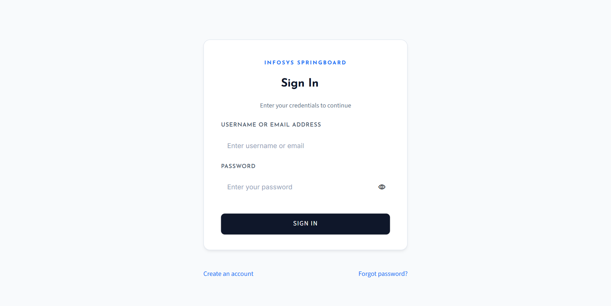
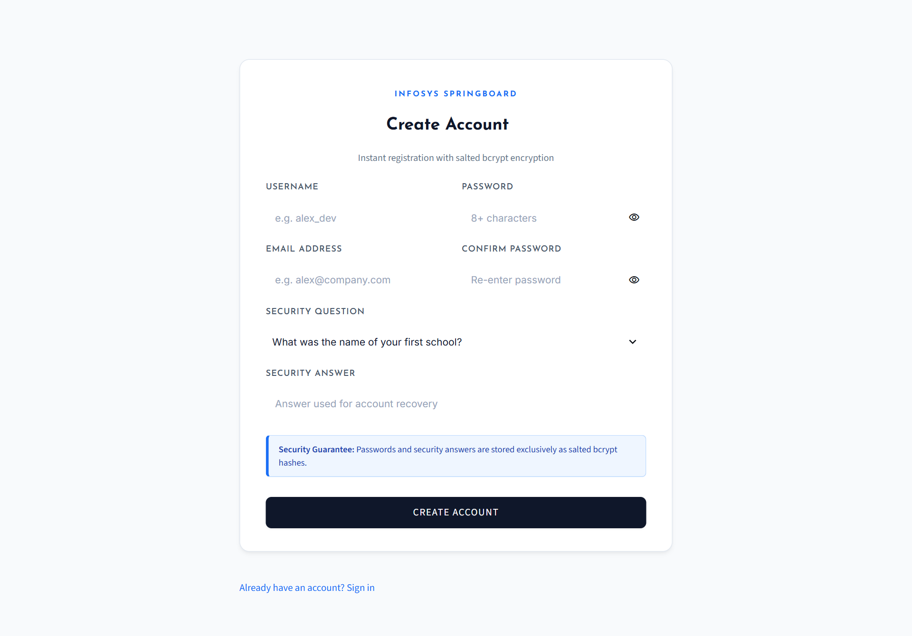
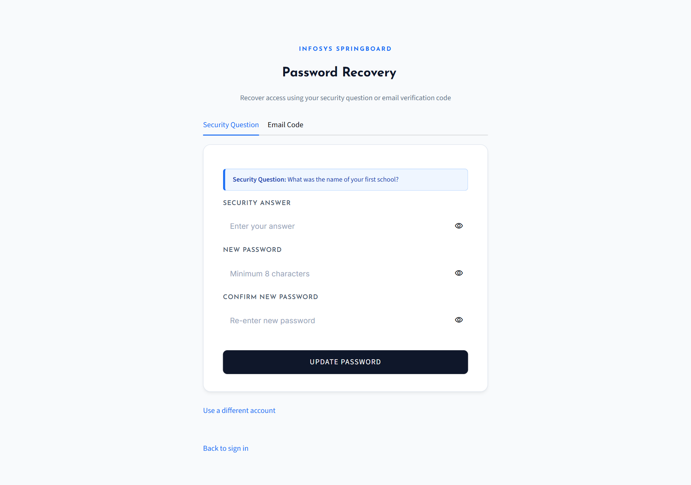
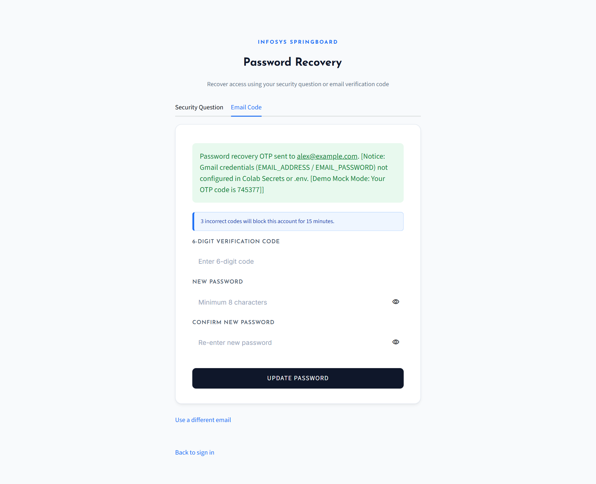
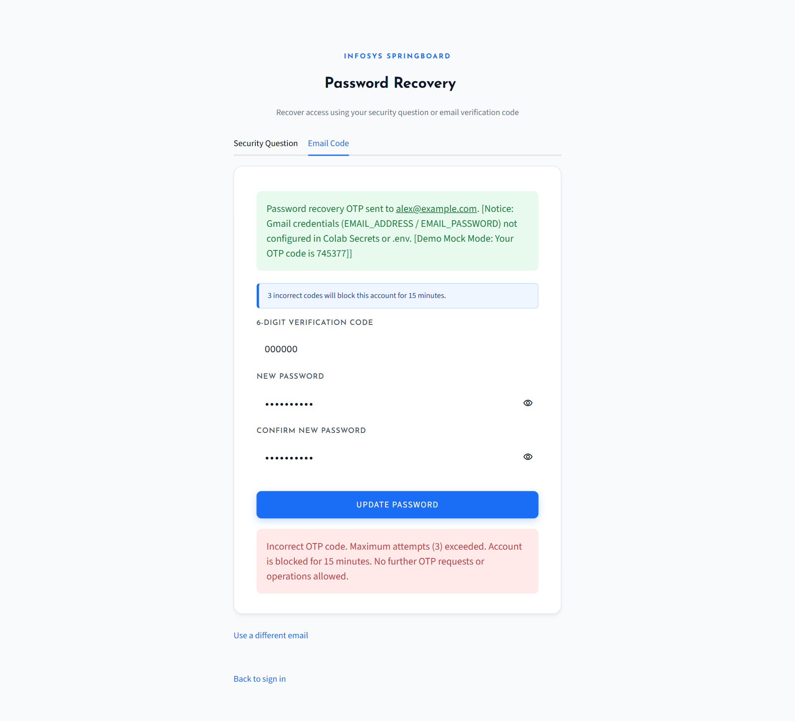
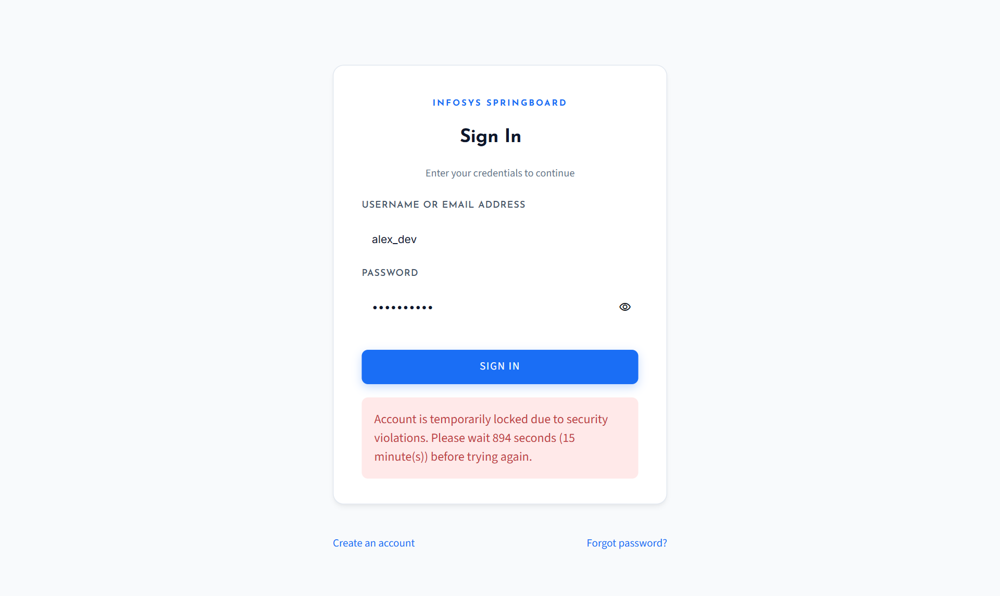
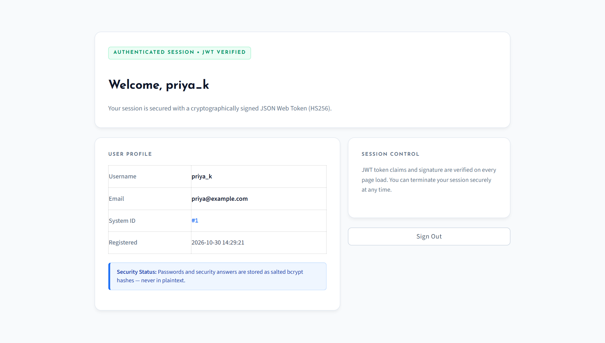
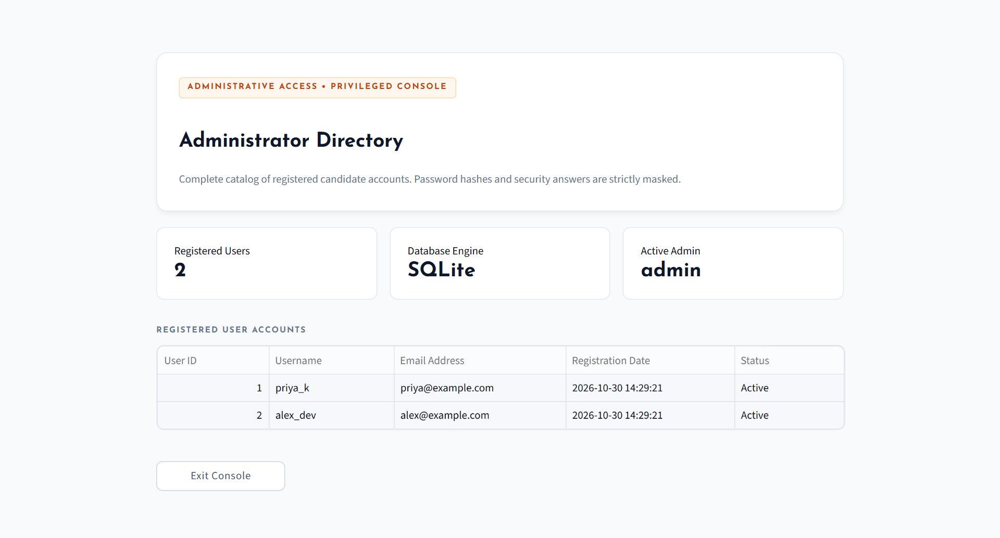

# Infosys Springboard Internship 7.0 (Batch 4)
## Milestone 1: User Authentication Module

---

### 1. Project Overview

A secure, modular authentication portal for **Milestone 1** of the Infosys Springboard Internship 7.0 (Batch 4), built with **Python, Streamlit, SQLite, bcrypt, PyJWT and Gmail SMTP**. It runs locally or in Google Colab through an ngrok tunnel.

Highlights: one sign-in page for users and the administrator, instant account creation, two password-recovery routes, and a 15-minute account block after 3 wrong OTP codes.

---

### 2. Key Features Implemented

1. **Direct Account Registration**:
   - Registration requires Username, Email, Password, Confirm Password, Security Question, and Security Answer.
   - No email OTP is needed to create an account; the record is saved immediately with salted bcrypt hashes.
2. **Dual-Identifier Login**:
   - One sign-in page for both users and the administrator, using **Username or Email Address** and Password.
   - 3 consecutive wrong passwords lock sign-in for 5 minutes.
   - Returns generic error messages (*"Invalid username/email or password."*) to prevent user enumeration attacks.
3. **JWT Session Management**:
   - Generates cryptographically signed **HS256 JSON Web Tokens (JWT)** upon successful authentication.
   - Stores session state in Streamlit and enforces token validity before rendering protected pages.
   - Secure logout mechanism clears session state and redirects to the Login view.
4. **Dual-Route Forgot Password Recovery**:
   - **Route A (Security Question)**: Look up the account by **username or email**, then answer the security question chosen during signup.
   - **Route B (Email OTP)**: Recovers account access by verifying a 6-digit one-time code sent to the registered email.
   - 3 incorrect OTP codes block the account for 15 minutes; no OTP requests or other operations are allowed during that time.
   - Both recovery flows enforce the exact same password complexity and confirmation rules.
5. **Role-Based Protected Dashboards**:
   - **User Dashboard**: Displays personalized welcome banner, profile details, registration date, and active JWT session status.
   - **Admin Management Console**: Administrator signs in through the same page and sees the registered user catalog (User ID, Username, Email, Registration Timestamp). In accordance with strict security standards, **password hashes and security answer hashes are never exposed**.
6. **Strict Field & Credential Validation**:
   - Mandatory check: No form submits with empty or whitespace-only inputs.
   - Email format: Enforces the Infosys rule requiring at least 2 characters before `@`, at least 2 characters between `@` and the dot, and at least 2 characters after the final dot (`ab@cd.ef`).
   - Password complexity: Minimum 8 characters, at least 1 uppercase letter, 1 lowercase letter, 1 numeric digit, and 1 special symbol.
7. **Single SQLite Database (`milestone1.db`)**:
   - Tables: `users`, `pending_signups`, `otp_codes`, `login_attempts`.
   - Passwords, security answers and OTP codes are stored only as salted bcrypt hashes.
8. **Automated Test Suite**:
   - 27 unit and integration tests covering validators, bcrypt, PyJWT, OTP limits/expiry, and complete authentication flows.

---

### 3. Technology Stack

| Technology | Purpose |
| :--- | :--- |
| **Python 3.10+** | Core programming language |
| **Streamlit** | Interactive web application framework with modern card styling |
| **SQLite3** | Single unified relational database engine |
| **bcrypt** | Salted cryptographic password and security answer hashing |
| **PyJWT** | HS256 signed JSON Web Tokens for session handling |
| **Gmail SMTP** | Automated OTP email delivery with anti-spam RFC headers |
| **pyngrok** | Secure tunnel exposing local Streamlit server via public URL |
| **pytest** | Automated test runner for unit and integration testing |
| **Google Colab** | Cloud notebook execution environment |

---

### 4. Standardized Project Structure

```
Milestone1/
├── README.md                          # Documentation & setup guide
├── Milestone1_Authentication.ipynb    # All-in-one Google Colab executable notebook
├── app.py                             # Entry point (runs src/app.py)
├── requirements.txt                  # Python package dependencies
├── screenshots/                      # UI demonstration captures
│   └── README.md
├── src/
│   ├── __init__.py
│   ├── config.py                     # Secrets loader (Colab userdata / .env)
│   ├── database.py                   # SQLite schema & connection management
│   ├── security.py                   # bcrypt hashing & PyJWT tokens
│   ├── validators.py                 # Email, password, and field validation
│   ├── otp_service.py                # 6-digit OTP engine & Gmail SMTP client
│   ├── auth_service.py               # Authentication & recovery business logic
│   └── app.py                        # Streamlit web application
└── tests/
    ├── __init__.py
    ├── test_validators.py            # Unit tests for input validation rules
    ├── test_security.py              # Unit tests for bcrypt & JWT
    ├── test_otp.py                   # Unit tests for OTP expiry, limits & hashing
    └── test_auth.py                  # Integration tests for auth, recovery & admin
```

---

### 5. Setup & Configuration Instructions

#### 5.1. Google Colab Secrets (Recommended)
When running inside Google Colab, open the **Secrets** panel (key icon in the left sidebar) and configure the following keys:

| Secret Name | Description | Example / Source |
| :--- | :--- | :--- |
| `NGROK_AUTHTOKEN` | Personal authtoken from ngrok | Copy from [ngrok dashboard](https://dashboard.ngrok.com/) |
| `EMAIL_ADDRESS` | Gmail address used as sender | `yourname@gmail.com` |
| `EMAIL_PASSWORD` | 16-character Gmail App Password | Generated from Google Account security |
| `JWT_SECRET` | Secret signing key for JWT tokens | Any long random string |
| `ADMIN_USERNAME` | (Optional) Admin portal login username | Defaults to `admin` |
| `ADMIN_PASSWORD` | (Optional) Admin portal login password | Defaults to `Admin@Infosys123` |

> **Important:** Ensure the toggle switch for **"Notebook access"** is turned **ON** for each secret.

#### 5.2. Gmail App Password Setup
1. Visit your Google Account: [myaccount.google.com](https://myaccount.google.com/).
2. Select **Security** and enable **2-Step Verification**.
3. In the search bar at the top, search for **App Passwords**.
4. Create a new app password labeled `"Infosys Portal"`.
5. Google will display a 16-character code. Copy this code into your `EMAIL_PASSWORD` secret (without spaces).

#### 5.3. ngrok Setup
1. Register for a free account at [ngrok.com](https://ngrok.com/).
2. Navigate to the **Your Authtoken** page in your dashboard.
3. Copy the token and paste it into `NGROK_AUTHTOKEN`.

---

### 6. How to Run

#### Option A: Running in Google Colab (Notebook)
1. Open [Google Colab](https://colab.research.google.com/).
2. Upload `Milestone1/Milestone1_Authentication.ipynb`.
3. Configure the secrets in the left sidebar as described in Section 5.1.
4. Run all cells sequentially (**Runtime -> Run all**):
   - Cell 1: Installs required packages (`streamlit`, `pyjwt`, `bcrypt`, `pyngrok`).
   - Cell 2: Validates configured Colab secrets.
   - Cell 3: Scaffolds source code files into `src/` and `tests/`.
   - Cell 4: Runs the complete automated test suite (`pytest tests -v`).
   - Cell 5: Starts the Streamlit application and outputs a live **ngrok Public URL**.
5. Click the generated public URL to access the live portal.

#### Option B: Running Locally

1. **Install Dependencies:**
   ```bash
   pip install -r Milestone1/requirements.txt
   ```

2. **Configure Environment Variables (Optional):**
   Create a `.env` file in the root or `Milestone1/` directory:
   ```env
   EMAIL_ADDRESS=your_email@gmail.com
   EMAIL_PASSWORD=your_16_char_app_password
   JWT_SECRET=your_jwt_secret_key
   ADMIN_USERNAME=admin
   ADMIN_PASSWORD=Admin@Infosys123
   ```

3. **Run Automated Test Suite:**
   ```bash
   python -m pytest Milestone1/tests -v
   ```

4. **Launch Streamlit Web Portal:**
   ```bash
   python -m streamlit run Milestone1/app.py
   ```
   Open your browser at `http://localhost:8501`.

---

### 7. Automated Test Suite

```bash
python -m pytest Milestone1/tests -v
```

| File | Tests | Covers |
| :--- | :---: | :--- |
| `test_validators.py` | 7 | Mandatory fields, email rule, password complexity, username format |
| `test_security.py` | 5 | bcrypt hashing, JWT creation and verification |
| `test_otp.py` | 6 | OTP format, hashing, expiry, attempt limits, 15-minute lockout |
| `test_auth.py` | 9 | Registration, login, both recovery routes, admin masking |

Result: **27 passed**.

---

### 8. User Interface Screenshots

*Screenshots demonstrating full functionality across all required views:*

#### 8.1. Sign In (users and administrator)


#### 8.2. Create Account


#### 8.3. Password Recovery - Security Question


#### 8.4. Password Recovery - Email Code


#### 8.5. Account Blocked After 3 Wrong OTP Codes


#### 8.6. Sign In While Blocked


#### 8.7. User Dashboard


#### 8.8. Administrator Dashboard

