# FranchiseOps AI: Milestone 3

Infosys Springboard Internship 7.0, Batch 4. Mentor: Mohamedsipli M.

**Milestone 3 finishes FranchiseOps AI.** The knowledge base grows to documents crawled from public websites, the Copilot answers from SQL (every number) and from RAG (documents with numbered sources), it can be taught new answers, every agent has a better simulator, and the Milestone 2 login, profile, role-based access and Admin dashboard now run inside the finished application.

**Stack:** FastAPI, SQLite, JWT (PyJWT) with bcrypt, role-based access control, RAG with BM25 + FAISS dense retrieval + reranking, Google Colab (T4 GPU), ngrok.

## Team

| Member | Area | What this area delivers in the final product |
|---|---|---|
| **Nishanth** | Knowledge base and integration | The RAG builder notebook (42 more public seed sites for franchise operations, labour rules, FSSAI and HACCP, supply chain and GST, up to 80 PDFs per site, a size report at the end). Integration of the Milestone 2 work into the finished application, the final Colab notebook, the notebook build tool, the tests and this documentation. |
| **Ayush** | Taught questions | 50 questions the Copilot could not answer, with correct answers and keywords, taught through Admin → Teach Copilot and exported to [`taught_questions.csv`](taught_questions.csv). Screenshots of the 50 / 50 counter and of a taught answer. |
| **Akshita** | Copilot fine-tuning | New SQL intents (profit and loss, sales and transactions by period, out-of-stock, campaigns, audits, absentees, tickets, rankings), new synonyms (including the customers table), the "I do not know" rule for questions the data cannot answer, and the before/after evaluator behind Admin → Copilot insights. |
| **Madhavi** | Agent simulators | The models behind the upgraded simulators: seasonality and stock-out probability, attrition by tenure with hiring versus overtime, price elasticity with a wage band, diminishing returns with campaign fatigue, the effect of fixing the top complaint, and audit failure risk. Rebuilt on the database in `app/sim_fr.py`. |
| **Sidesh** | Authentication and security | Sign-up, JWT sign-in, bcrypt password hashing, lock after 5 wrong passwords, recovery by e-mail code and by security question, profile photo (`app/accounts.py`), now serving the whole finished app. |

## What is in this folder

| Item | Purpose |
|---|---|
| [`FranchiseOpsAI_RAG_Builder.ipynb`](FranchiseOpsAI_RAG_Builder.ipynb) | Crawls the seed websites, finds the PDFs, saves them to `MyDrive/FranchiseOps_AI/rag_pdfs/`, extracts the text and builds the FAISS and BM25 indexes. **Run it first.** |
| [`FranchiseOps_AI_v5.ipynb`](FranchiseOps_AI_v5.ipynb) | The finished application as one Colab notebook. Run it second. Generated from `app/` by `tools/build_notebook.py`. |
| [`taught_questions.csv`](taught_questions.csv) | The 50 taught questions (`question,answer,keywords,added_by,when`). Loaded automatically at start. |
| [`app/`](app) | The application source (server, agents, Copilot, RAG, simulators, front end). |
| [`tests/`](tests) | 332 automated tests (Milestone 2 suite plus Milestone 3). |
| [`docs/`](docs) | Access-control notes and a demo script. |
| [`screenshots/`](screenshots) | Screenshots used below. |
| [`slides/`](slides) | The 6-slide presentation (PPTX and PDF). |

---

## 1. How to run

### In Google Colab

1. Open `FranchiseOpsAI_RAG_Builder.ipynb`, choose **Runtime → Change runtime type → T4 GPU**, **Runtime → Run all** and allow Google Drive access. When it finishes it prints how many PDFs are in `rag_pdfs/` and how many chunks were indexed. If it reports fewer than 150 PDFs, raise `MAX_PDFS_PER_SEED` or `MAX_CRAWL_DEPTH` (or add seeds to `FRANCHISE_SEEDS`) and run it again.
2. Open `FranchiseOps_AI_v5.ipynb` with a T4 GPU. In the left sidebar open **Secrets** (key icon), add the secrets below and turn **Notebook access** ON for each. **Never type a password, token or key into a cell.**

| Secret | Used for |
|---|---|
| `JWT_SECRET` | Signs the login tokens. A random one is created if it is missing. |
| `ADMIN_PASSWORD` | Password of the Admin account. A random one is printed when the server starts if it is missing. |
| `ADMIN_EMAIL_ID` | E-mail of the Admin (default `admin@infosys.com`). |
| `EMAIL_ADDRESS`, `EMAIL_PASSWORD` | Gmail sender and 16-character app password for recovery codes, reports and digests (optional). |
| `NGROK_AUTHTOKEN` | The public link (recommended). |
| `HF_TOKEN` | Faster model downloads (optional). |

3. **Runtime → Run all.** With `USE_DRIVE = True` the app loads the chunks the RAG builder saved; with `PERSIST = True` users, taught questions and chats are backed up to Drive and restored after a runtime reset. The notebook prints one demo login per role (random passwords made at start-up, nothing stored in the code) and the **Open the app** link.
4. Sign in as `admin` (or your `ADMIN_EMAIL_ID`) with your `ADMIN_PASSWORD`, or with one of the printed demo logins. Everyone else uses **Create an account**.

### On your own computer

```bash
pip install fastapi "uvicorn[standard]" python-multipart pandas numpy scikit-learn scipy vaderSentiment requests bcrypt pyjwt pdfplumber reportlab matplotlib langdetect
cd Milestone3/app
APP_KIND=Franchise JWT_SECRET=<long random string> ADMIN_PASSWORD=<your password> uvicorn server:app --port 8000
```

Open http://localhost:8000. Without a GPU the language model and translation are off; SQL answers, the agents, BM25 retrieval, taught answers and the simulators all work.

---

## 2. Milestone 2 inside the finished application

The finished application had its own sign-in. The Milestone 2 login was kept because it is the stronger one: bcrypt instead of a plain salted hash, a JWT that carries only the user id (role, outlet and lock state are read from the database on every request, so a promotion or lock applies at once), a lock after 5 wrong passwords that an Admin must lift, recovery by e-mail code or security question, and no default passwords anywhere in the code.

| Milestone 2 feature | In the finished app |
|---|---|
| Sign-up, sign-in, sign-out, JWT sessions | Used by every page and API route (`accounts.py`). |
| Forgot password by e-mail code and by security question, locked-account guard | Login screen, unchanged. |
| Profile page with photo, username, password, security question | **My Profile**, plus a Preferences card (answer language, critical alerts, daily digest). |
| Role-based access with server-side 403 | One table for every page and action (`rbac.py`); see below. |
| One-outlet scope for Store Manager and Staff | Applies to the Copilot (SQL, agents, documents), pages, detail drawer, tickets, pulse and reports. |
| Admin dashboard (users table, add, delete with confirmation, promote and demote, lock and unlock, activity log, KPI cards, privilege table) | **Admin → Users & access**, the first tab of the Admin page. |
| IST timestamps | The server runs on Asia/Kolkata and the screens show IST. |
| 23 SQL question patterns with spelling tolerance, SQL and row count under every answer, polite fallback with three valid questions | First layer of the Copilot; the fallback now begins with "I do not know". |
| Redesigned interface, light and dark themes, phone layout | The whole application. |
| Zero secrets in code | Secrets come from Colab Secrets or environment variables. Demo accounts get random passwords at start-up. |

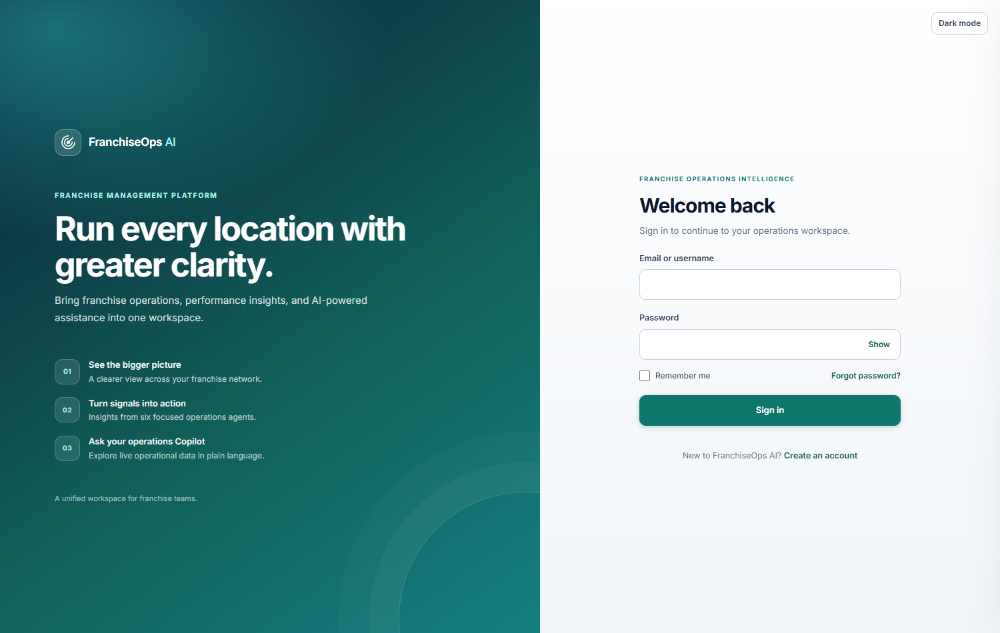

### Access matrix

An unauthorised role is refused by the server with **403**, not only hidden in the menu.

| Role | Copilot | Approvals | Command Center | Workforce | Outlets | Inventory | Marketing | Sentiment | Audit | Digital Twin | Reports | Notifications | Data feeds | Run agents | Approve | Users |
|---|---|---|---|---|---|---|---|---|---|---|---|---|---|---|---|---|
| Admin | ✓ | ✓ | ✓ | ✓ | ✓ | ✓ | ✓ | ✓ | ✓ | ✓ | ✓ | ✓ | ✓ | ✓ | ✓ | ✓ |
| Franchise Owner | ✓ | ✓ | ✓ | ✓ | ✓ | ✓ | ✓ | ✓ | ✓ | ✓ | ✓ | ✓ | ✓ | ✓ | ✓ | ✗ |
| Store Manager | ✓ | ✓ | ✓ | ✓ | ✓ | ✓ | ✗ | ✓ | ✓ | ✓ | ✓ | ✓ | ✗ | ✗ | ✗ | ✗ |
| Staff | ✓ | ✗ | ✗ | ✗ | ✗ | ✗ | ✗ | ✗ | ✗ | ✗ | ✗ | ✗ | ✗ | ✗ | ✗ | ✗ |
| Auditor | ✓ | ✓ | ✓ | ✓ | ✓ | ✓ | ✓ | ✓ | ✓ | ✗ | ✓ | ✓ | ✗ | ✗ | ✗ | ✗ |

Store Manager and Staff see one outlet only. Staff and Auditor never see salary or personal data in the Copilot. Only the Admin opens the Admin page, Teach Copilot, Copilot insights, policies, backups and data governance.

A Staff account sees only the Copilot and My Profile; opening the Admin page by URL is refused with `403 Forbidden: the Staff role cannot open the admin page.`

| Staff menu | Admin page refused (403) |
|---|---|
| 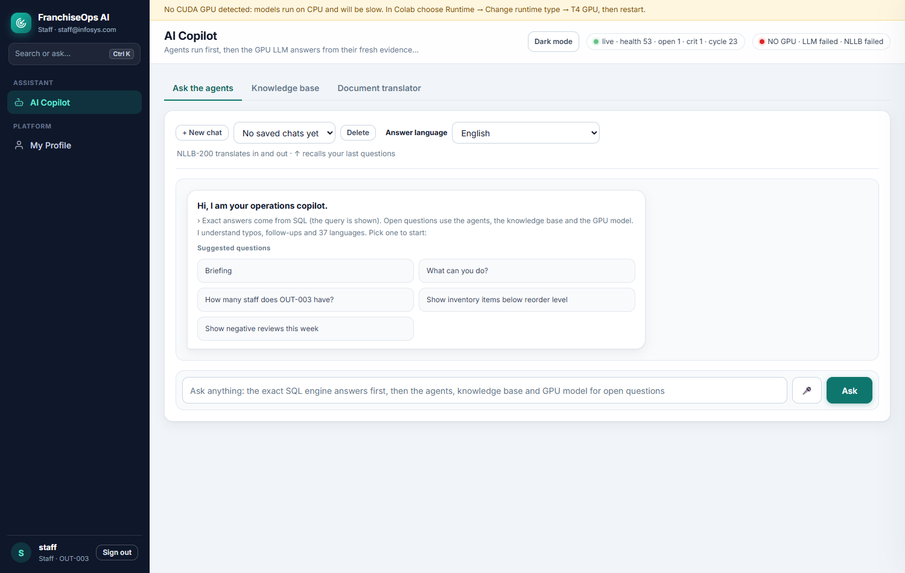 | 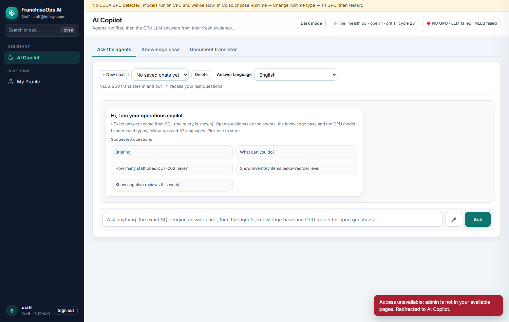 |

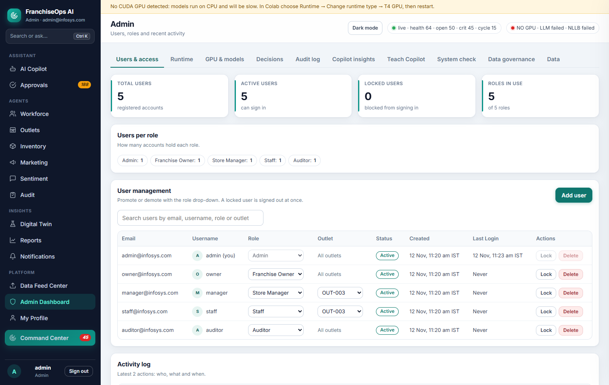

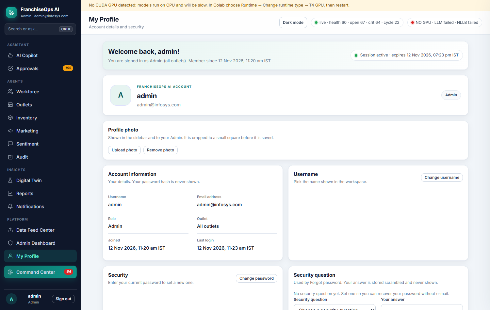

---

## 3. How the Copilot uses SQL and RAG

Every question goes through the same layers, in this order:

1. **Taught answers** (Admin → Teach Copilot), matched also for rephrased questions.
2. **SQL.** Intent patterns (`INTENTS` in `copilot_pro.py`, the 23 Milestone 2 patterns in `intents.py`) and the schema-driven engine (`qa.py`, synonyms) turn the question into a read-only SQL query. **Every number comes from SQL**; the query and the row count are shown under the answer.
3. **Agents.** The six agents' latest findings, for open questions that need reasoning.
4. **RAG.** Documents (the built-in policy pack, your RAG builder chunks, uploaded documents and taught answers) are retrieved with BM25 and dense embeddings, fused with Reciprocal Rank Fusion and reranked. The answer is short, numbered, cites sources as **[1] [2]** and lists them under **Sources**.
5. **The language model** (Qwen on the T4 GPU) only rephrases evidence it is given. A model answer that contains a number that is not in the evidence is thrown away.
6. **"I do not know."** When nothing answers the question, or the data can never answer it (weather, competitors, forecasts), the Copilot says so, logs the question for Teach Copilot and names three questions it can answer.

A Store Manager or Staff account only ever gets its own outlet: another outlet's id in a question is refused, the chain-wide agent findings and live document hits are not used, and any answer that would mention another outlet is replaced.

| SQL answer with the query | Answer with numbered sources |
|---|---|
| 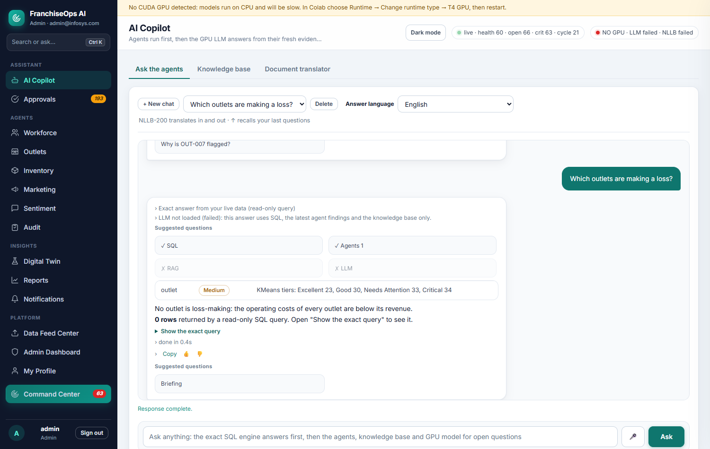 | 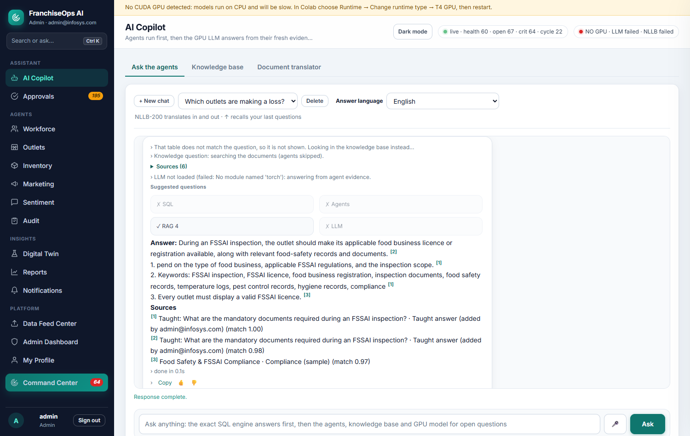 |

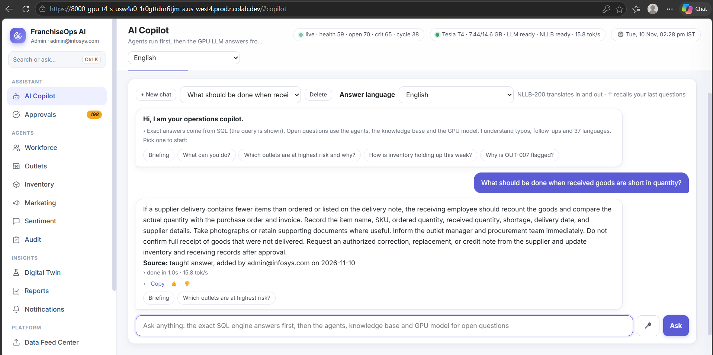

## 4. Knowledge base

`FranchiseOpsAI_RAG_Builder.ipynb` crawls 107 public seed sites (the original 65 plus 42 added in this milestone) that cover franchise operations, labour rules, FSSAI and HACCP, supply chain, GST, customer service, marketing and audits. It follows links two levels deep, downloads up to 80 PDFs per site, extracts the text, splits it into 400-word chunks with 50 words of overlap, and writes a FAISS index and a BM25 index to `MyDrive/FranchiseOps_AI/`. Duplicates are removed by URL. The last lines of the run report the PDF count and the chunk count.

The application reads those chunks when it starts (`USE_DRIVE = True`). **Admin → System check** then lists "Knowledge base (RAG)" with the number of chunks, split into the built-in pack and your Drive chunks. Documents can also be added in AI Copilot → Knowledge base and exported or imported as a corpus.

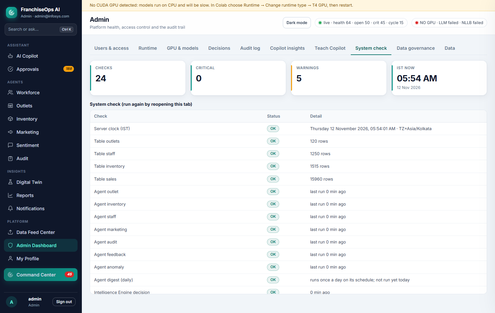

## 5. Taught questions

[`taught_questions.csv`](taught_questions.csv) holds 50 different questions from franchise operations, staffing, food safety, inventory, procurement, finance and customer service. Each has a complete answer and keywords for rephrased versions. The application loads the file when it starts and skips questions that are already taught, so Admin → Teach Copilot always shows **50 / 50**. The same file can be imported there (**Import CSV**) and exported again.

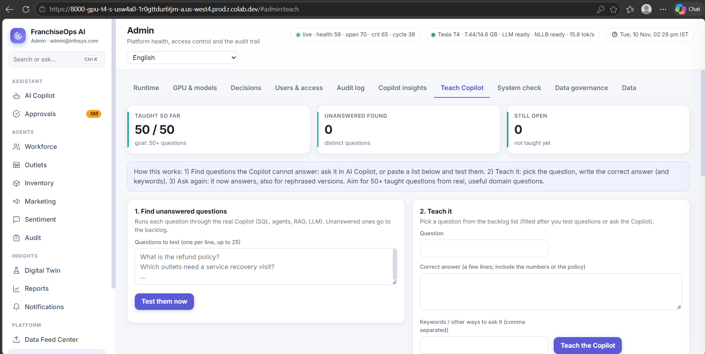

## 6. Copilot fine-tuning

Akshita's patches are part of `copilot_pro.py` (`TUNED_INTENTS`, `TUNED_UNSUPPORTED`), `qa.py` (`TUNED_COLUMN_SYNONYMS`, `TUNED_TABLE_SYNONYMS`, `TUNED_TABLES`) and `views_misc.py`. To teach a new question add one line to `TUNED_INTENTS` (pattern, title, SQL) or a word to a synonym dictionary.

The evaluator (`copilot_eval.py`) replays 109 answerable and 31 out-of-scope questions through the real layers (no GPU, no language model) on the live database, once with the original files (`app/_orig/`) and once with the tuned files. A question counts as *answered* when an on-topic exact SQL answer comes back, and as *verified correct* when its numbers match an independent query. Measured on the simulated database of this repository:

| Question set | Answerable | Answer rate before → after | Verified correct before → after | Says "I do not know" when it should |
|---|---|---|---|---|
| Tuning (used to write the patterns) | 56 | 66% → 96% | 25% → 93% | 7 of 15 → 15 of 15 |
| Paraphrases | 30 | 37% → 100% | 10% → 100% | 4 of 8 → 7 of 8 |
| Blind (written after tuning, run once) | 23 | 57% → 78% | 35% → 74% | 1 of 8 → 5 of 8 |
| **All** | **109** | **56% → 94%** | **23% → 91%** | **12 of 31 → 27 of 31** |

The blind row is the honest one. The questions that still fail are listed in the same panel, so each one is a pattern or synonym to add next. In Colab run the last cell of the notebook once, then open **Admin → Copilot insights**.

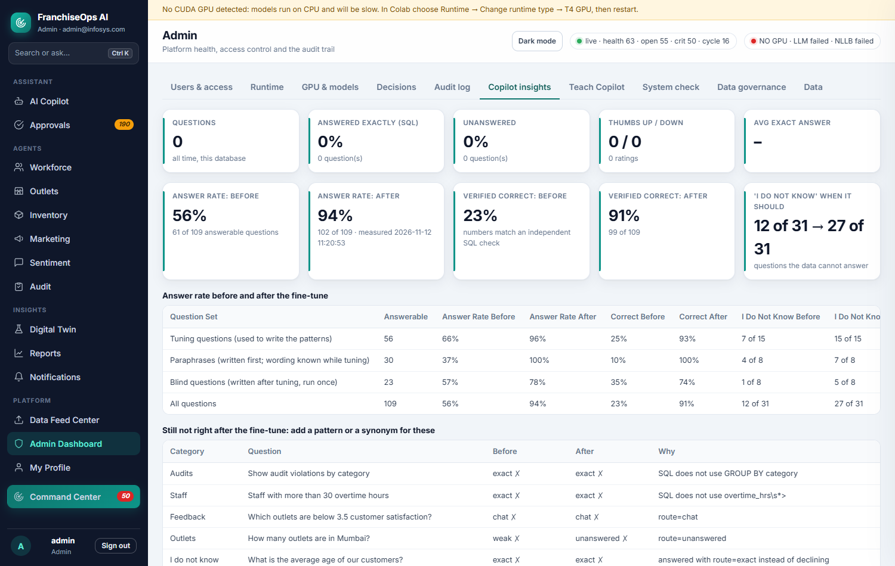

## 7. Agent simulators

Each agent page has a **Simulator** tab. All six read their starting values from the database, never change live data, list their assumptions, show a **10th to 90th percentile range** instead of one number, and take a **random seed** (the same seed gives the same result; the baseline and the scenario of a run share their random numbers). The Digital Twin and the Monte Carlo panels use the same models.

| Agent | What was added | Before | After |
|---|---|---|---|
| Inventory | Demand seasonality (weekly and festive), random supplier delays, stock-out probability and service level, three reorder rules compared on the same futures | 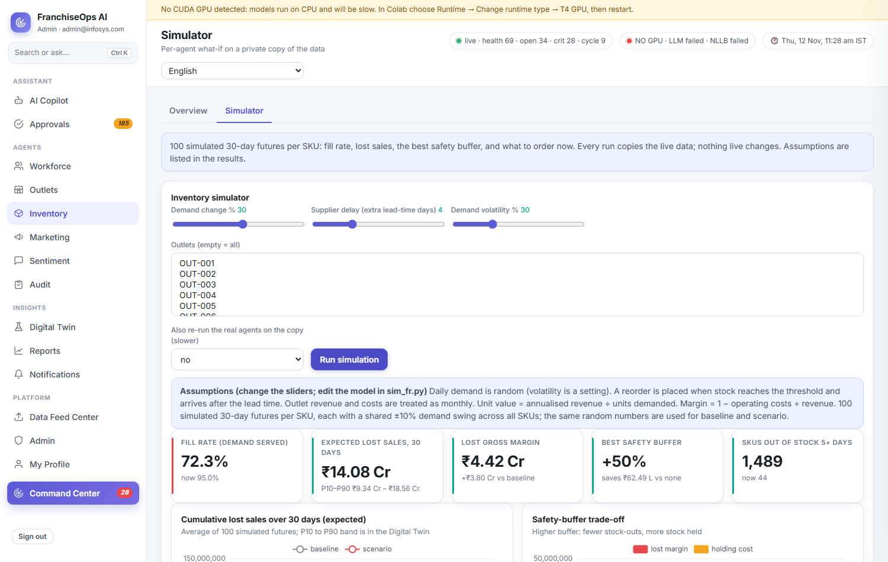 | 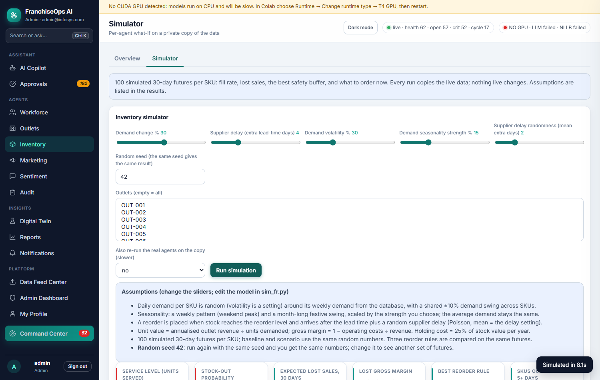 |
| Workforce | Attrition by tenure band, hiring lead time, overtime versus hiring cost over a horizon | 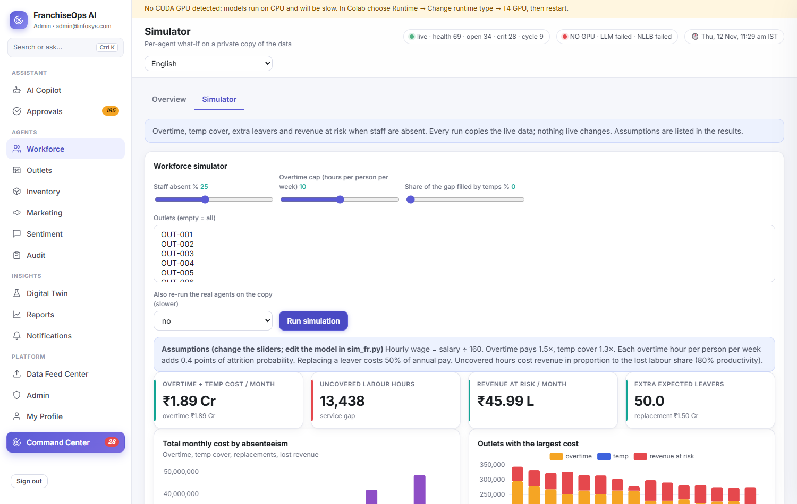 | 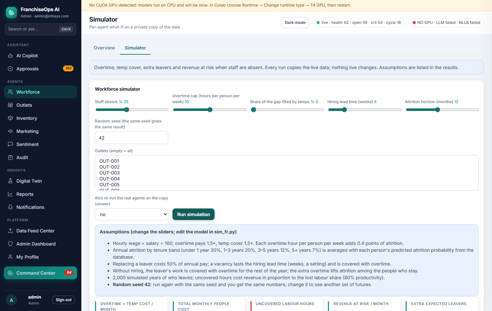 |
| P&L | Price elasticity setting, wage and rent inflation, best and worst case band | 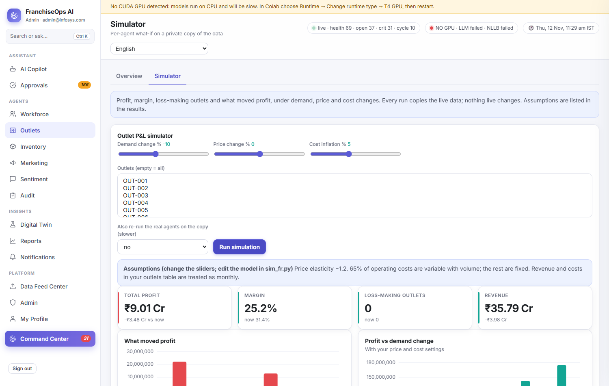 | 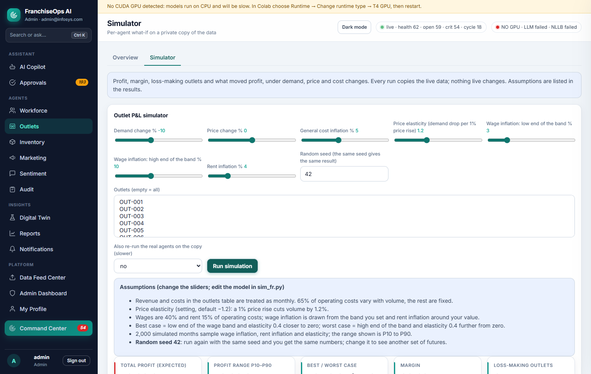 |
| Marketing | Diminishing returns plus campaign fatigue, ROI by channel with a range | 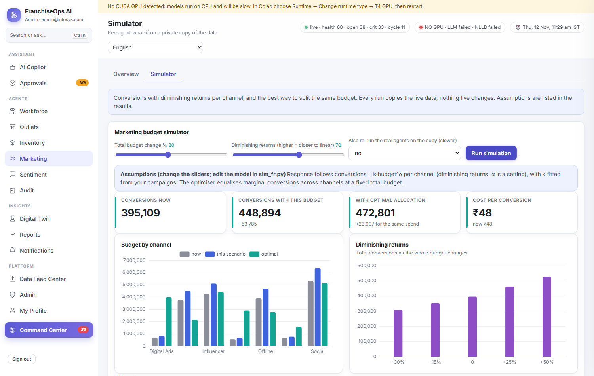 | 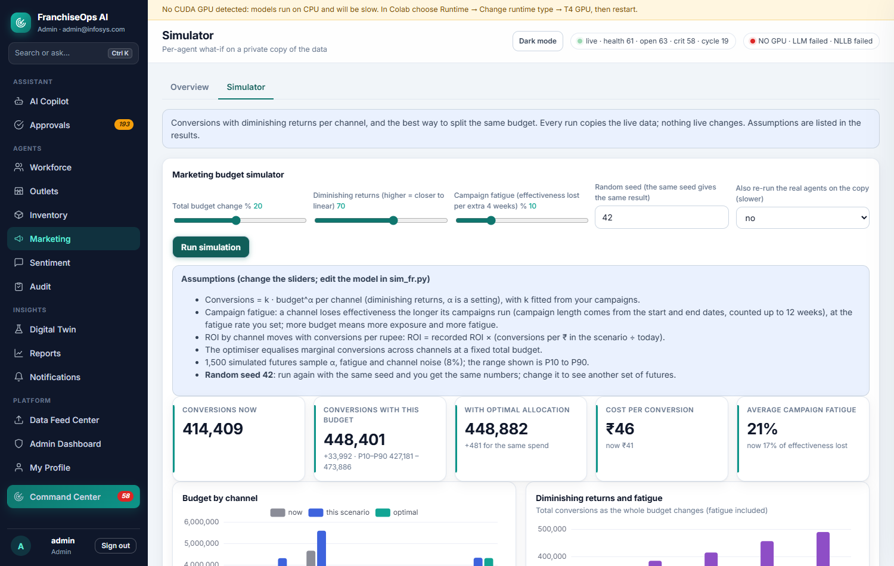 |
| Sentiment | Effect of fixing the most common complaint on CSAT, repeat visits and revenue | 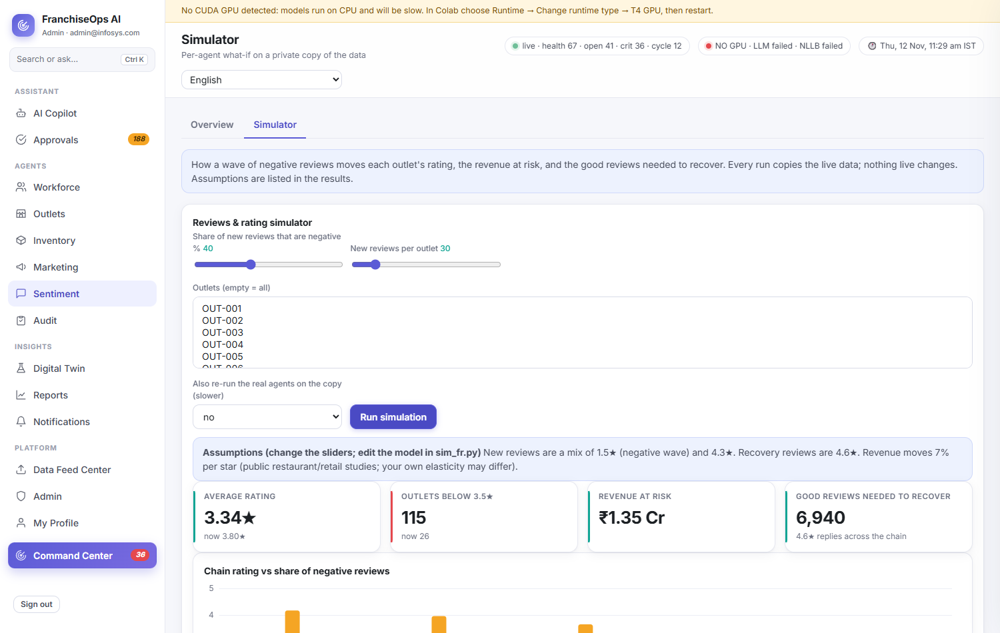 | 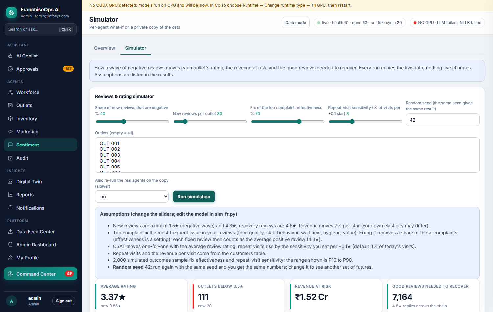 |
| Audit | Chance of failing the next audit from open findings, closing rate and days to become compliant | 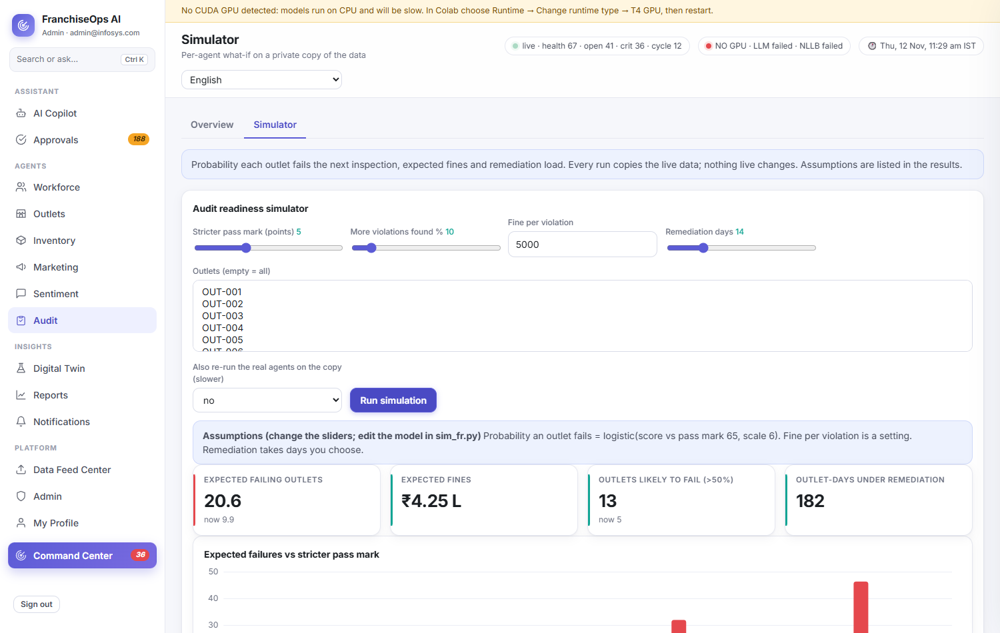 | 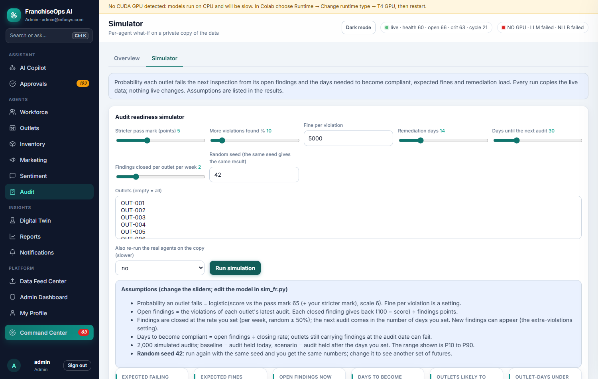 |

## 8. Tests

```bash
pip install pytest httpx
pytest Milestone3/tests
```

332 tests: access control (every role against every page and action, with an allowed and a denied case), accounts and recovery, the Copilot, and the Milestone 3 additions (simulators repeat with a seed and never change live data, 50 taught questions load, Admin-only tools answer 403 to every other role, scoped roles never see another outlet).

## 9. Security notes

- No secret, token, password or database is stored in the repository. `.env`, `*.db`, `.jwt_secret` and `.admin_initial` are ignored.
- Without `ADMIN_PASSWORD` the server makes a random Admin password and prints it once. Demo accounts (`DEMO_USERS`) use random passwords printed in the notebook.
- Passwords are hashed with bcrypt; the same error is given for an unknown user and a wrong password; the last Admin can never be removed, demoted or locked.
- Free-text reviews have e-mail addresses and phone numbers removed before storage; salary and personal data are hidden from Staff and Auditor.
